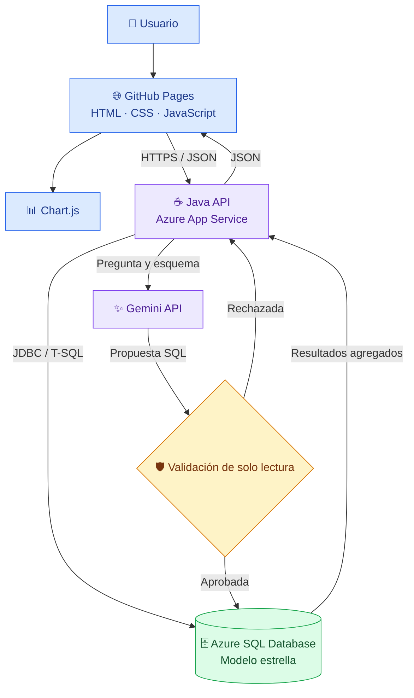
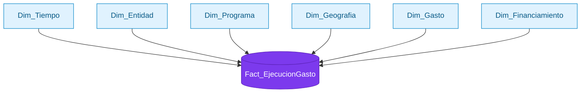
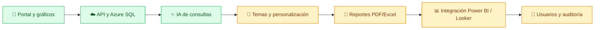

<div align="center">

# 🧬 COVID-19 | DATA WAREHOUSE INTELLIGENCE

### Plataforma de análisis presupuestal, Business Intelligence e inteligencia artificial

**Del dato público a decisiones informadas.**

  

    

[🌐 Abrir portal](https://rtx3050ti.github.io/portal-datawherehouse/) · [📁 Repositorio](https://github.com/RTX3050TI/portal-datawherehouse) · [🐛 Reportar problema](https://github.com/RTX3050TI/portal-datawherehouse/issues)

</div>

---

## ✨ Visión general

Este proyecto académico explora la **ejecución del gasto público asociado a COVID-19 en Perú** mediante un **Data Warehouse con modelo estrella**, un **portal web de visualización** y un **asistente de IA** capaz de convertir preguntas en lenguaje natural en consultas analíticas SQL.

> **Principio:** facilitar la exploración y comprensión de datos presupuestales, sin sustituir una auditoría ni afirmar causalidad a partir de cifras agregadas.

### 🎯 Objetivos

- Consultar indicadores de presupuesto, certificación, compromiso, devengado y girado.
- Comparar resultados por entidad, programa, tiempo, financiamiento y territorio.
- Visualizar análisis predefinidos mediante gráficos interactivos.
- Explorar preguntas adicionales mediante un asistente de IA con acceso **solo de lectura**.
- Preparar el camino para integrar reportes BI y exportación de resultados.

## 🧭 Arquitectura general



**Nota de seguridad:** el diagrama describe el diseño deseado. La seguridad real requiere validación robusta del SQL, permisos de lectura en Azure SQL y límites de ejecución; un prompt por sí solo no es una barrera de seguridad.

## 🧱 Modelo dimensional



| Componente | Función |
|---|---|
| `Fact_EjecucionGasto` | Métricas monetarias: PIA, PIM, certificado, comprometido, devengado y girado |
| `Dim_Tiempo` | Año, mes y denominación del mes; el mes `0` se trata separadamente como registro fiscal |
| `Dim_Entidad` | Nivel de gobierno, sector, pliego y ejecutora |
| `Dim_Programa` | Programa presupuestal, proyecto/producto, función y meta |
| `Dim_Geografia` | Departamento, provincia y distrito de la ejecutora |
| `Dim_Gasto` | Categoría, genérica, subgenérica y específica |
| `Dim_Financiamiento` | Fuente y rubro de financiamiento |

> **Calidad analítica:** `monto_girado` representa el monto girado; no existe `monto_pagado` en el esquema descrito. Evita presentar el girado como confirmación bancaria del pago. Filtra por año cuando se comparen meses de distintos ejercicios.

## 📊 Catálogo de 20 análisis predefinidos

<details open>
<summary><b>📈 Ejecución y financiamiento · 01–05</b></summary>

| ID | Pregunta |
|---|---|
| 01 | ¿Cuánto fue el monto devengado por mes? |
| 02 | ¿Cuáles son las 15 entidades ejecutoras con mayor monto devengado? |
| 03 | ¿Cómo se distribuyen los montos certificado, devengado y girado por fuente de financiamiento? |
| 04 | ¿Cuál fue el monto devengado por categoría de gasto? |
| 05 | ¿Cómo se comparan mensualmente el devengado y el girado? |

</details>

<details>
<summary><b>📉 Brechas y ciclo presupuestal · 06–13</b></summary>

| ID | Pregunta |
|---|---|
| 06 | ¿Qué ejecutoras presentan mayor diferencia entre certificado y devengado? |
| 07 | ¿Cuáles son los 10 programas con mayor diferencia entre certificado y devengado? |
| 08 | ¿Cuál es el monto devengado por departamento, de menor a mayor? |
| 09 | ¿Cómo se comparan certificado y devengado por año? |
| 10 | ¿Cuál es el total certificado frente al comprometido? |
| 11 | ¿Cuál es el total comprometido frente al devengado? |
| 12 | ¿Cuál es el total devengado frente al girado? |
| 13 | ¿Qué diferencias agregadas existen entre las etapas del ciclo del gasto? |

</details>

<details>
<summary><b>🗺️ Territorio y programas · 14–20</b></summary>

| ID | Pregunta |
|---|---|
| 14 | ¿Qué departamentos registran mayor monto devengado? |
| 15 | ¿Cuáles son los 10 departamentos con mayor monto devengado? |
| 16 | ¿Cuáles son las 10 provincias con mayor monto devengado? |
| 17 | ¿Cuáles son los 10 distritos con mayor monto devengado? |
| 18 | ¿Cuáles son los 15 grupos de nombres de programas con mayor monto devengado? |
| 19 | ¿Cuáles son los 15 grupos de nombres de productos/proyectos con mayor monto devengado? |
| 20 | ¿Cuál es el monto devengado por función del Estado? |

</details>

> Los análisis 08, 14 y 15 son variantes de un mismo indicador territorial. En las consultas 18 y 19, el SQL actual agrupa nombres truncados a 40 caracteres; esto puede combinar categorías diferentes. Se recomienda corregirlo en una versión posterior.

## 🧠 Asistente de IA

**Ejemplo de interacción**

```text
Usuario: ¿Qué departamentos presentan mayor monto devengado?
   ↓
Gemini: genera una consulta SELECT sobre el esquema permitido
   ↓
Backend: valida la consulta y aplica permisos de solo lectura
   ↓
Azure SQL: calcula los agregados
   ↓
Portal: presenta resultados y visualizaciones
```

**Preguntas sugeridas:** «¿Cuál fue el gasto por año?», «Muéstrame las ejecutoras con mayor devengado», «¿Cómo evolucionó el girado por mes?» y «¿Qué fuente de financiamiento concentra mayor ejecución?».

**Controles recomendados:** credenciales en variables de entorno; usuario SQL dedicado con `SELECT` exclusivamente; lista permitida de tablas; parser T-SQL o plantillas verificadas; límite de filas y tiempo; registros de auditoría sin secretos; restricciones CORS por origen y protección frente a abuso de la API.

## 🛠️ Stack tecnológico

| Capa | Tecnologías |
|---|---|
| Frontend | HTML5, CSS3, JavaScript |
| Gráficos | Chart.js |
| API | Java, `HttpServer`, JDBC |
| Datos | Microsoft SQL Server, Azure SQL Database |
| Nube | Azure App Service |
| IA | Google Gemini API |
| Publicación | Git, GitHub, GitHub Pages |
| Migración | Exportación/importación BACPAC |
| BI externo | Power BI / Looker Studio (integración propuesta) |

## 📂 Estructura del repositorio

```text
portal-datawherehouse/
├── index.html      # Estructura del portal
├── stylo.css       # Apariencia y diseño adaptable
├── app.js          # Interacciones, gráficos y consumo de API
└── README.md       # Documentación del proyecto (este archivo)
```

**Importante:** el backend Java y las credenciales no forman parte de estos tres archivos visibles del repositorio. La API se despliega de forma independiente en Azure App Service.

## 🚀 Ejecutar y publicar

**Frontend local**

```bash
git clone https://github.com/RTX3050TI/portal-datawherehouse.git
cd portal-datawherehouse
python -m http.server 5500
```

Abre `http://localhost:5500` y verifica que `app.js` apunte a una API disponible. Los gráficos dinámicos necesitan conectividad con el backend.

**GitHub Pages**

1. En el repositorio, abre **Settings → Pages**.
2. Selecciona **Deploy from a branch**.
3. Escoge `main` y `/ (root)`.
4. Guarda y espera la publicación.
5. Accede a `https://rtx3050ti.github.io/portal-datawherehouse/`.

**Backend en Azure**

Configura el JAR ejecutable, el puerto proporcionado por el entorno, la conexión cifrada a Azure SQL y las variables de entorno necesarias. Nunca publiques contraseñas, tokens ni claves de API en GitHub. Si alguna credencial estuvo expuesta, **rótala antes de continuar**.

## 🛡️ Seguridad y privacidad

- El frontend público **no** debe contener contraseñas SQL ni claves de Gemini.
- El backend es el único responsable de conectarse a la base de datos y al proveedor de IA.
- Las preferencias visuales pueden almacenarse en `localStorage`, pero **no** los secretos.
- Los resultados son información presupuestal; deben presentarse con filtros, período y unidades claramente identificados.
- Las consultas generadas por IA no deben ejecutarse sin una capa de autorización y validación independiente del modelo.

## 🗺️ Hoja de ruta



Los pasos de la hoja de ruta son orientativos y no garantizan que cada función ya esté publicada.

## 🎓 Contexto académico

**Universidad Nacional Santiago Antúnez de Mayolo (UNASAM)**  
**Escuela profesional:** Ingeniería de Sistemas e Informática  
**Ubicación:** Huaraz, Áncash, Perú  
**Año:** 2026

**Integrantes:** completar con los nombres del equipo responsable de este proyecto.  
**Docente / curso:** completar según el curso al que se presente.

## 🤝 Contribuciones y contacto

Las sugerencias y reportes de errores pueden registrarse en [GitHub Issues](https://github.com/RTX3050TI/portal-datawherehouse/issues). No compartas claves, datos privados ni cadenas de conexión en las incidencias.

---

<div align="center">

### 💜 Datos que cuentan historias. Análisis que inspira decisiones.

**Hecho con Java · Azure · SQL Server · JavaScript · IA**

[⬆ Volver al inicio](#-covid-19--data-warehouse-intelligence)

</div>
